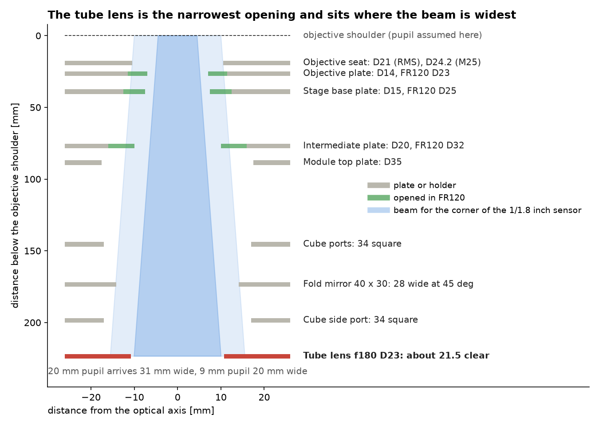
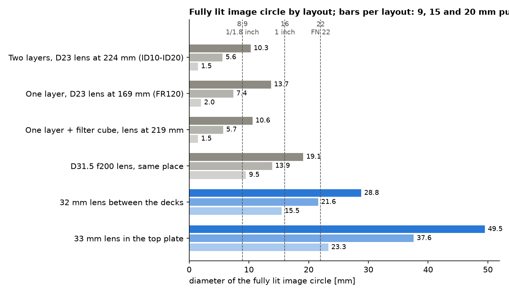

# Optical path (ID10–ID20)

The detection path is infinity-corrected: objective, collimated space through the stand and the optics drawer, fold mirror, tube lens, camera. This page gives the openings, the distances and what they mean for the field of view.

The values are from the CAD of unit 10 and from a ray model. They have not been confirmed by a flat-field measurement yet.

## The column

| Element | Distance below the objective shoulder | Clear opening FR110 | Clear opening FR120 |
|---|---|---|---|
| Objective seat | 19 mm | 21 mm (RMS), 24.2 mm (M25) | same |
| Objective plate | 26 mm | 14 mm | 23 mm |
| Stage base plate | 39 mm | 15 mm | 25 mm |
| Intermediate plate | 77 mm | 20 mm | 32 mm |
| Top plate of the optics drawer | 88 mm | 35 mm | 35 mm |
| Cube ports | every 50 mm | 34 x 34 mm | same |
| Fold mirror, 40 x 30 mm at 45° | 174 mm (two layers), 119 mm (one layer) | 28 mm | same |
| Tube lens, f = 180 mm, diameter 23 mm | 224 mm (two layers), 169 mm (one layer) | about 21.5 mm | same |

The beam for an off-axis image point widens by 0.05 mm per millimetre of path for the corner of the standard sensor. A 20 mm pupil is 31 mm wide when it reaches the tube lens. The lens passes about 21.5 mm.

## Field number and field of view

A field number is the diameter of the intermediate image that the instrument delivers fully lit. For this hardware it depends on the objective's pupil:

| Objective pupil | Examples | Fully lit image circle | Circle at 50 % brightness |
|---|---|---|---|
| 9 mm | 4x/0.10, 10x/0.25, 60x/1.40 | 10.3 mm | 16.8 mm |
| 15 mm | 20x/0.75 | 5.6 mm | 15.8 mm |
| 20 mm | 4x/0.20 | 1.5 mm | 14.5 mm |

So the field number is about 10 for the standard plan objectives. The standard camera has an 8.9 mm diagonal and uses almost all of it. With large-pupil objectives the corners of that sensor fall to 86 % (20x/0.75) and 71 % (4x/0.20).

With a one-layer drawer (lens at 169 mm) the fully lit circle grows to 13.7 mm for a 9 mm pupil.

Field of view at the sample with the standard camera (7.37 x 4.92 mm sensor) and the f = 180 mm tube lens, for objectives designed for a 180 mm tube lens:

| Objective | Field of view | Pixel at the sample |
|---|---|---|
| 4x | 1.84 x 1.23 mm | 0.60 µm |
| 10x | 0.74 x 0.49 mm | 0.24 µm |
| 20x | 0.37 x 0.25 mm | 0.12 µm |

Objectives designed for a 200 mm tube lens magnify 0.9 times these values. Always calibrate the pixel size on your unit; see [Calibrate pixel size](../../guides/day-2/calibrate-pixel-size/README.md).

## Sampling

A 10x/0.25 objective resolves about 1.0 µm at 520 nm and needs pixels of 0.52 µm at the sample. The standard camera delivers 0.24 µm. Low-NA objectives are therefore oversampled about 2.2 to 2.7 times. Binning 2 x 2 brings the sampling close to the optical limit and makes the pixels four times brighter.

## What changes the field

The lower two rows are planned layouts: a 32 mm lens between the two cube layers, ahead of the fold mirror, lights a 1 inch sensor for pupils up to 15 mm. The lens swap in row four uses the existing 31.5 mm f = 200 mm lens.

Rule for any opening you add to the collimated space: its diameter should be at least the objective pupil plus 0.09 mm per millimetre of distance from the objective, for a 16 mm image circle behind f = 180 mm.

## Objectives

- Two positions, 29.8 mm apart, on a motorised slider below the stage.
- Thread RMS or M25 x 0.75. Each objective sits on a support that sets its parfocal height (16.4 mm for the Plan 4x, 12.4 mm for the 20x), so a pair stays in focus after a change.
- The listed objectives are corrected for a 0.17 mm cover glass. Through the 1 mm plastic bottom of a standard well plate, a 20x/0.40 loses about half of its peak intensity. Use glass-bottom plates or a long-working-distance objective at 20x and above.

## Transmitted light

| Element | Position above the sample | Data |
|---|---|---|
| Ground-glass diffuser, 25.4 mm | 42 mm | limits the illumination NA to 0.29 |
| Asphere, f = 19 mm, 12 mm diameter | about 95 mm | collimates the centre LED |
| LED board with centre LED and RGB rings, 49 mm wide | about 105 mm | about 20 W with all LEDs on, cut-off at 100 °C |

The light is diffuse. There is no field stop and no aperture stop, and the LED cannot be centred. The ring LEDs act as patterned illumination (darkfield, DPC) only with the diffuser removed; the widest ring reaches NA 0.21.

## Fluorescence

- Excitation enters through a kinematic dichroic cube in the upper cube layer, 118 mm below the objective.
- Filter set in use: quad band for 405, 488, 532 and 638 nm. Dichroic 25.2 x 35.6 mm, exciter and emitter 25 mm.
- The red line must be 636 to 644 nm. The exciter passes only 30 % at 635 nm.
- The emitter passes near infrared (98 % at 850 nm). A focus-lock laser at 850 nm needs its own blocking filter in front of the camera.

## Camera position

The standard camera sits on a 100 mm C-mount tube. Its sensor is 238 mm from the optical axis and stands about 120 mm in front of the frame.
