# Stage repeatability and drift (ID10–ID20)

Without an encoder the X axis of unit 10 returned to a target within about ±7 µm over 24 hours of random moves, with backlash of 1 to 15 µm. A linear encoder can hold the stage inside a ±7.8 µm zone and recover lost steps. Drift at rest was 0.1 to 0.2 µm per hour on unit 10.

These numbers come from two internal test series in 2026. They cover one or two units, mostly the X axis, at room temperature unless stated. Treat them as typical values, not as guaranteed specifications.

| Test | Unit | Result |
|---|---|---|
| 24 h random moves, open loop, linear encoder as observer | 10 | X within about ±7 µm, Y within ±1.5 µm; 4 lost-step events in 779 moves |
| 24 h random moves, open loop, rotary encoder as observer | 10 | X within about ±3 µm; 8 lost-step events in 781 moves |
| Backlash, 10 rounds per setting | 10 | 1 to 15 µm, depending on position, direction and speed |
| Drift at rest, 12 h, 20x | 10 | X 0.1 µm/h, Y 0.2 µm/h |
| Drift at rest, 12 h, 20x, earlier unit | 9 | X about 1.5 µm/h |
| Drift with stage moves, 5 to 13 h, 4x to 20x, room temperature and 37 °C | earlier runs | 1 to 20 pixels per hour; Y steadier than X |

## How the encoder tests were done

Source: firmware repository `uc2-esp32`, pull request 135, folder `tools/PYTHON/encoder_test`. The scripts there repeat every test.

- Unit 10, 20x objective, camera as the reference. A black dot on a calibration slide is the target; its position in the image gives the true stage position.
- The encoder sits on the X axis: either a linear magnetic encoder at the plate (1.95 µm per count) or a rotary encoder on the motor (0.25 µm per count).
- The motor runs open loop. The encoder only observes, so the plots show what the stage does without correction and what the encoder would have seen.
- Speed 100,000 steps/s (31 mm/s), acceleration 100,000 steps/s² (31 mm/s²).

## 24 hours of moves

The stage alternates between the calibration slide in slot 1 and a sample in slot 4, 92.5 mm apart, every 10 minutes, with two to five random moves in between.

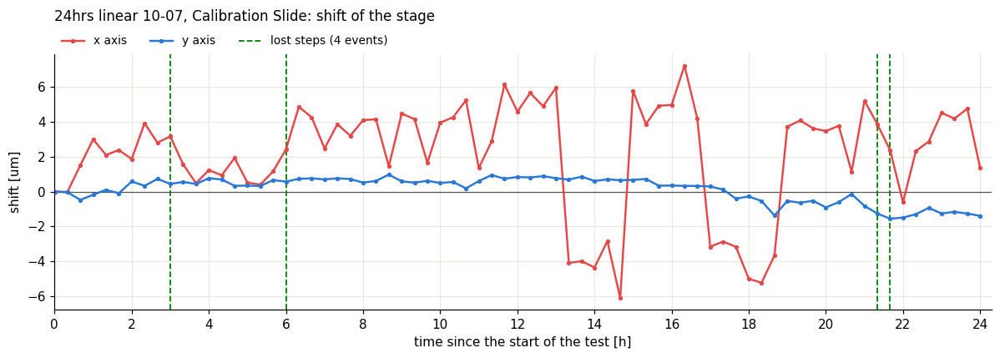

In the run with the linear encoder the X position scatters between -6 and +7 µm. Y, which moves less, stays within ±1.5 µm. The dashed lines mark four moves in which the motor lost steps.

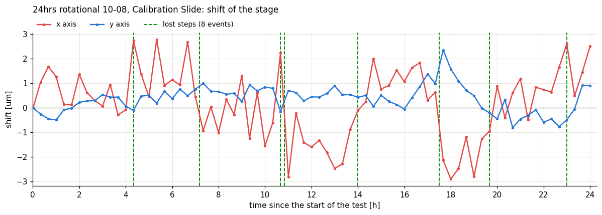

The second run, a day later, stays within about ±3 µm in X and counts eight lost-step events.

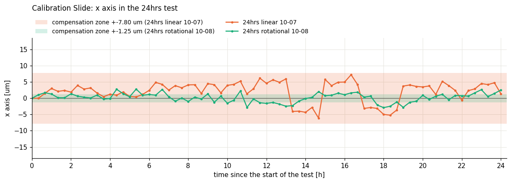

The shaded bands are the zones in which a closed loop would hold the stage: ±7.8 µm for the linear encoder (4 counts) and ±1.25 µm for the rotary encoder (5 counts).

### What each encoder sees

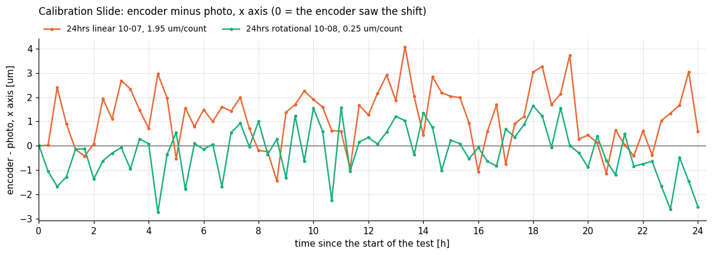

The plot shows the encoder reading minus the true position from the camera. Zero means the encoder saw the full error.

- The linear encoder reads the plate itself. Its error stays within about -1.5 to +4 µm, limited by its 1.95 µm count.
- The rotary encoder reads the motor shaft. It is finer (0.25 µm) but blind to everything after the motor: screw, nut and plate. Its error stays within ±2.5 µm here.

This is why X and Y get linear encoders. The focus axis gets a rotary encoder, because its travel is short and its load path from motor to wedge stage is direct. The objective slider gets none.

### Lost steps

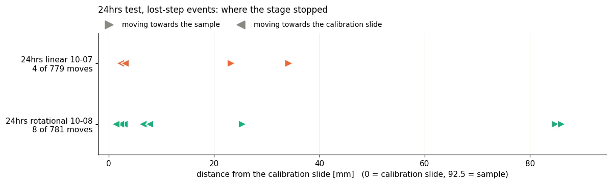

Lost steps happened in 4 of 779 and 8 of 781 moves, most of them within 10 mm of the calibration slide, at the end of the long move. With the encoder in the loop the firmware handles the first event of a move without a fault: the axis stops, takes over the encoder position and continues to the target at a reduced speed of 10,000 steps/s. A second event in the same move latches a fault.

Without an encoder a lost step shifts every later position until the next homing.

## Backlash

The stage moves 256 steps in one direction, an image is taken, the stage moves 20,000 steps on and returns. The difference between the two images is the backlash. "Slow" is 10,000 steps/s, "fast" is 100,000 steps/s.

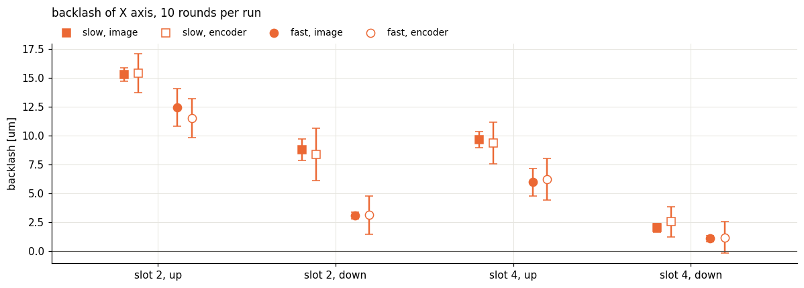

| Position and direction | Slow | Fast |
|---|---|---|
| Slot 2, up | 15 µm | 12.5 µm |
| Slot 2, down | 9 µm | 3 µm |
| Slot 4, up | 9.5 µm | 6 µm |
| Slot 4, down | 2 µm | 1 µm |

Backlash is not one number for an axis. It is larger at low speed, near the middle of the travel and close to the motor. A single backlash value in the configuration therefore corrects only part of it. The linear encoder measures the same backlash as the camera to within one or two counts (filled against open symbols), so closed-loop operation removes it down to the encoder resolution.

To check the backlash of your own unit see [Axis backlash](../../guides/day-2/axis-backlash/README.md).

## Drift at rest

A dot is imaged every 10 minutes for 12 hours with the stage standing still, at room temperature.

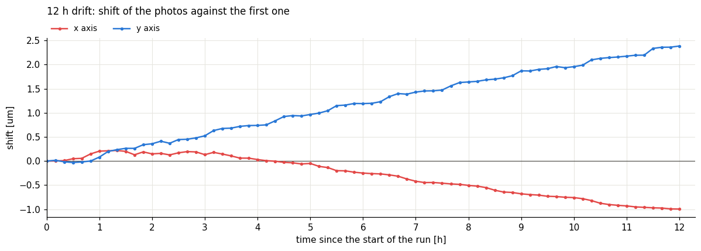

Unit 10 drifts 1 µm in X and 2.4 µm in Y over 12 hours: 0.1 and 0.2 µm per hour. The same test on unit 9 had shown about 1.5 µm per hour in X.

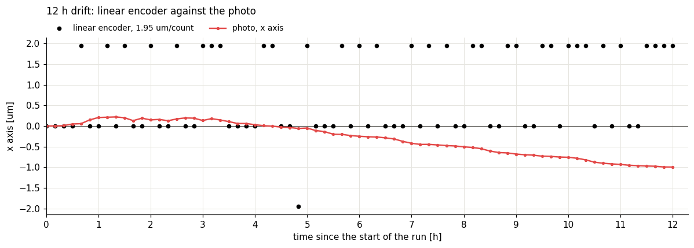

The linear encoder stays within one count over the whole run. Slow drift between objective and sample is not a stage position error, so no stage encoder can correct it. It needs a warm-up, a stable room, or correction from the image.

## Earlier drift series (2026)

Before the encoder tests, drift was recorded in several runs of 5 to 13 hours with 4x, 10x and 20x objectives, with and without incubation at 37 °C. The stage moved between two to four targets on a calibration slide between images.

| Run | Conditions | Result |
|---|---|---|
| 1 | 10x, three targets, 5 h, daytime, room temperature | X within ±6 pixels; one Y step of about 360 pixels at 150 min |
| 2 | 10x, three targets, 12 h, overnight | about 6 pixels/h in X and 2 pixels/h in Y on the grid target |
| 3 | 10x, four targets, 6 h, foam box at 37 °C | two Y steps of several hundred pixels; between them Y holds within ±2.7 µm |
| 4 | 10x, one target, stage at rest, 12 h, overnight | 40 pixels in X, 4 pixels in Y after settling |
| 5 | 20x, three targets, 5 h, 37 °C | X 4 pixels/h, Y 7 pixels/h |
| 6 | 20x, stage at rest, 12 h, overnight | X 6 pixels/h, Y 1.5 pixels/h |
| 7 | 4x, one target, 13 h, stage-top incubator at 37 °C | X 1 pixel/h, Y 1 pixel/h |
| 8 | 4x, three targets, 12 h, stage-top incubator at 37 °C | X 10 pixels/h, Y 20 pixels/h |

The plots print a pixel size of 0.153 µm (runs 1 to 3) or 0.24 µm (later runs). It was not calibrated per objective, so compare the runs in pixels.

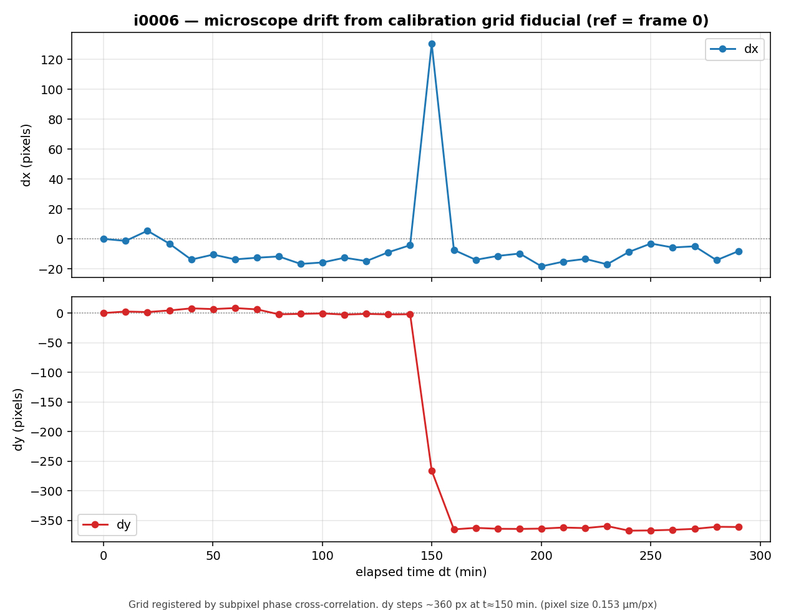

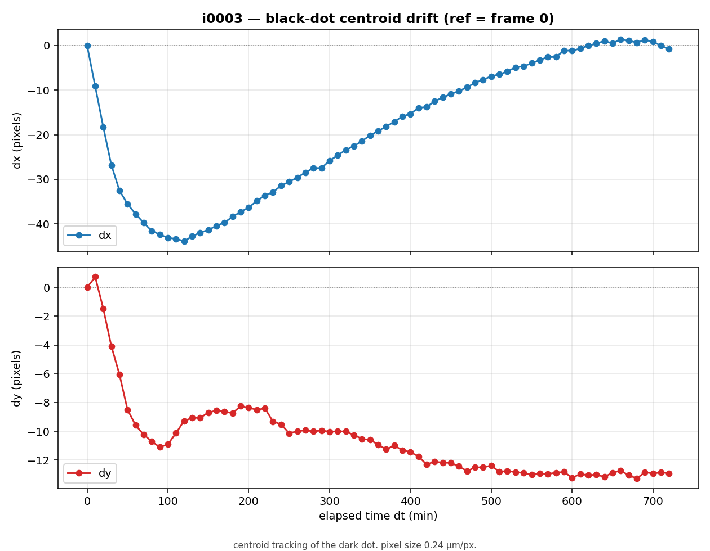

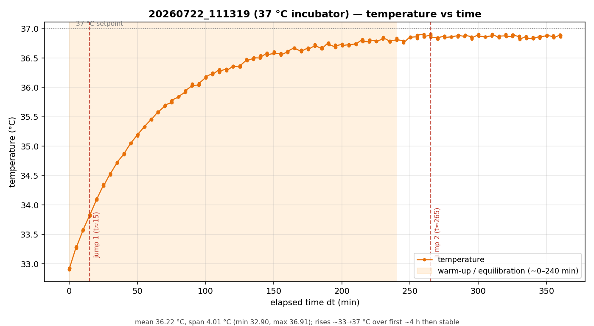

What these runs show:

- **Sudden steps of tens of micrometres** appear only in runs in which the stage moves between images. They match lost steps, as the encoder tests later confirmed.
- **Y is steadier than X** in almost every run. X is the lower axis and carries the Y axis, both focus drives and their boards.
- **The first hour drifts most.** After a start or a move the image settles over 30 to 100 minutes.
- **A foam enclosure needs about 5 hours to settle at 37 °C.** Drift with and without incubation was of similar size once settled.
- Some frames came back empty or were taken while the stage was still moving. They were removed from the analysis.

## What this means for use

| If you need | Do this |
|---|---|
| The same field after hours of multi-position imaging | use a unit with linear encoders in closed loop, or re-register on a fiducial |
| Tiles that stitch without gaps | plan an overlap of at least 15 µm on an open-loop unit; approach every tile from the same direction |
| Sub-micrometre stability over hours | let the unit warm up for an hour with motors on, keep the stage at rest, and correct residual drift from the image |
| Incubation at 37 °C | start the heating 5 hours before the experiment |

## How to repeat the tests

The scripts are in `uc2-esp32/tools/PYTHON/encoder_test`:

| Script | Test |
|---|---|
| `encoder_24h_repeatability.py` | 24 h random moves between a calibration slide and a sample |
| `encoder_backlash.py` | backlash by position, direction and speed |
| `encoder_thermal_drift.py` | drift at rest over 12 h |
| `encoder_closed_loop.py` | quick check of the four motor modes |

Use a calibration slide with a dot or a cross grid as the target. A dot of 0.15 mm and a cross grid with 0.01 mm divisions worked best in the drift series.
