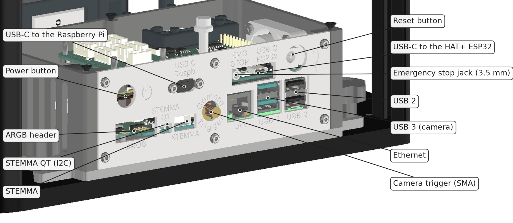

# Parts and connectors

This page says what plugs in where on a FRAME of the ID10–ID20 range. Board-level detail is in [Electronics and safety functions](../hardware-id10-id20/electronics-and-safety.md).

## External connectors

The connectors sit on the back panel of the electronics box, under the stage at the back of the unit.

| Connector | Type | Use |
|---|---|---|
| Power | barrel jack 5.5 / 2.5 mm, centre positive, on the HAT+, at the side of the electronics box | 12 V DC from the supplied power supply only |
| Emergency stop (EMG STOP) | 3.5 mm jack | external stop button; bus power stays off without it |
| Power button | push button | marked ⏻ on the panel |
| USB-C "Raspb." | USB-C | network link to the Raspberry Pi over USB |
| USB-C "ESP32" | USB-C | HAT+ ESP32: a short cable to a USB port of the Raspberry Pi carries the commands; also used to write firmware |
| Reset | push button | reset, next to the ESP32 port |
| Camera trigger | SMA | trigger output to the camera, needed for fast scans |
| LAN | RJ45 | network |
| USB 3 | 2 x USB-A, blue | camera |
| USB 2 | 2 x USB-A | Wi-Fi stick, accessories |
| ARGB, STEMMA QT, STEMMA | headers | LED strip, I2C sensors |
| USB-C, one per motor axis | on the stage claddings at the front right, labelled X, Y, Z, A | firmware update of that axis |

Plug the emergency stop in before the power supply. The unit ships with a plug that closes the stop circuit. Pulling it removes power from the motors, the lamp and the lasers; the Raspberry Pi stays on. All cables in the order of a first set-up: [commissioning checklist](../../guides/day-1/hw-assembly/README.md).

## Power supply

Mean Well GSM90A12-P1M: 12 V DC, 6.67 A, 80 W, input 100 to 240 V AC. Use only this type or the GSM90B12. There is no power switch on the unit: shut down in ImSwitch, wait 30 seconds, then pull the plug.

## Internal parts

| Part | Where |
|---|---|
| Raspberry Pi 5 with HAT+, cooler and NVMe base | electronics box at the back, held by two star knobs |
| Storage | micro SD card; an NVMe base sits under the Pi (drive depends on the configuration), see [troubleshooting / hardware](../../guides/troubleshooting/hardware/README.md) |
| Motor boards for X and the objective slider | under the stage base plate |
| Motor boards for Y and focus | on the Y plate, inside the stage |
| Lamp board | in the lamp head |
| Laser interface with key switch | in the laser module at the side |
| Camera | on the optics drawer, at the front |

## Mechanical interfaces

| Interface | Data |
|---|---|
| Sample holder | 170 x 130 mm insert, held by magnets |
| Objective | RMS or M25 x 0.75, on a three-point mount with a support per objective |
| Optics drawer | 3 x 3 cubes of 50 mm; slides in from the front and is clamped from above |
| Slot above the drawer | 33 mm high; flat modules slide in from the side |
| Side port | modules dock at the right side and are held by two M5 star knobs |
| Lamp arm | two M5 screws at the back |
