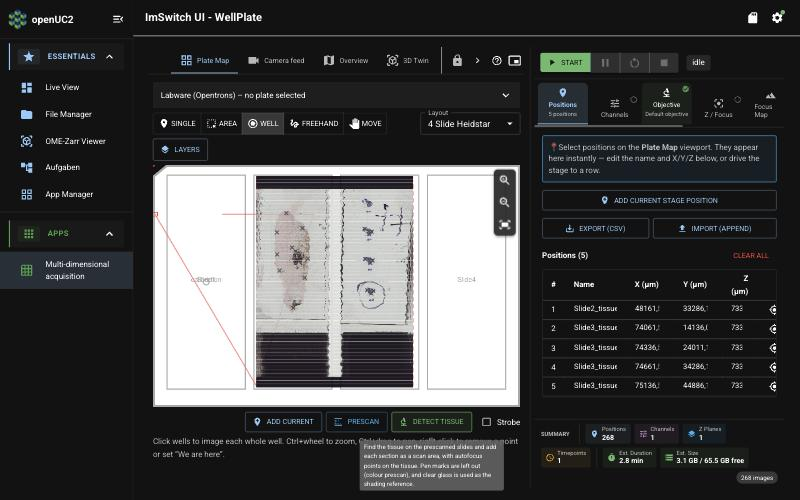
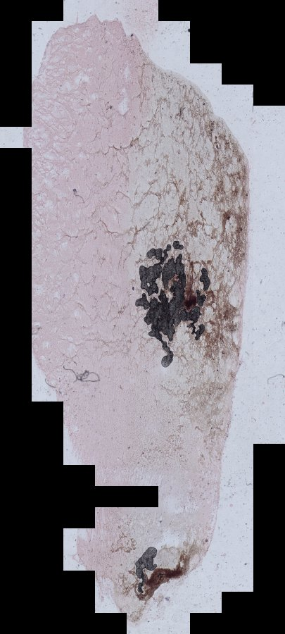

# Scan the tissue on histology slides

In this tutorial you scan every tissue section on up to four slides with the 4x objective. You select the slides, and the FRAME takes a quick colour overview of them, the *prescan*. On the prescan it finds the tissue and plans one scan area per section, places focus points on the tissue and picks a spot of clear glass to correct the illumination. Then it scans the tissue and nothing else.

Everything happens in the *Wellplate* app. The steps build on the tutorial [Run a large-area (stitched) scan on a slide](../stitching-scan-on-a-slide/README.md); read that one first if the app is new to you. *Why* each step works the way it does is explained in [How whole-slide scanning works](../../../explanations/whole-slide-scanning/README.md).

*The Wellplate app after Detect tissue: the prescan of two slides under the plate map, focus points (crosses) on the sections, one position per section in the list and 268 tiles in the summary.*

## What you need

- A FRAME with the 4x objective, a colour camera and the *4 Slide Heidstar* sample holder.
- Stained slides, for example H&E or IHC. With a colour camera the FRAME tells pen marks apart from stain. A greyscale camera finds pen marks as tissue.
- A homed stage: the slide outlines of the layout assume the stage was homed after it was switched on ([homing](../../../guides/day-2/homing/README.md)).
- Free disk space: about 30 MB per tile with both the OME-Zarr and the stitched OME-TIFF on. The 1.3 × 3.4 cm section shown at the end of this page was 195 tiles at 4x, about 6 GB. The size estimate in the app is lower than that.

## Step 1 — Focus and set the light in Live View

- In the *Live View* app, move to a section, switch on the *LED* and bring the section into focus.
- Set the exposure so that the glass is bright but not white: nothing in the histogram may sit at the right end. On our FRAME 0.25 ms worked. At 0.28 ms parts of the glass were saturated, and the shading reference (step 7) is refused when more than 0.2 % of its pixels are.
- The prescan uses the light exactly as it is set here.

## Step 2 — Select the slides

- Open the *Wellplate* app and choose the layout *4 Slide Heidstar*.
- Choose *Well* in the tool row and click each slide that carries sections. Each click adds the whole slide as one position.
- Alternatively, choose *Area* and drag one rectangle over the slides.

## Step 3 — Prescan

- Press *Prescan*. The stage sweeps the selected slides line by line at full speed, and the overview appears under the plate map line by line. Two slides take about 4 minutes. Leave the stage alone while it runs.
- The first lines may look shifted sideways while the prescan runs. The FRAME measures the delay between the camera and the moving stage on the way, and lays the early lines out again when the prescan ends.
- *Strobe*, next to the buttons, only works on FRAMEs whose electronics flash the LED for every frame. Otherwise leave it as it is.

## Step 4 — Detect tissue

- Press *Detect tissue*. After a second a message says what it did, for example:

  > 5 tissue region(s) added. focus map on, 22 focus point(s) on the tissue. 15 pen mark(s) left out. shading correction on, reference on clear glass.

- What happened:
  - Each section became one scan area in the position list, named after its slide (*Slide2_tissue1*, …). Sections closer than 3 mm to each other share one area, and so one image. The outline of an area follows the tissue with a margin, and the area is tiled again when you change the objective.
  - The slide selections from step 2 were removed.
  - Focus points were placed on the tissue, shown as crosses on the plate map, and the focus map was switched on.
  - Pen marks were left out, a spot of clear glass was chosen for the shading reference, and the shading correction was switched on.
- Check the result: zoom into the plate map. Remove an area you do not want with the bin icon in the position list. If a piece of tissue is missing, add it with *Area* or *Freehand*.
- With a greyscale camera, delete the areas that cover pen marks.

## Step 5 — Check the channel

- On the *Channels* tab the *LED* must be on, with the intensity and exposure from step 1. If not, press *Read and apply current exp/gain/LED settings*.
- If no channel is on, the scan keeps the light exactly as it is at the start. The message in step 4 says so.

## Step 6 — Check the focus settings

- On the *Z / Focus* tab keep *Single Z*: the focus map sets the Z of every tile.
- Under *Advanced Settings*, *Range (±μm)* and *Resolution (μm)* define each focus search. At 4x, ±150 µm in steps of 15 µm worked; one focus point takes about 8 seconds. When the best focus lies just outside the range, the FRAME searches once more, centred on that edge.
- On the *Focus Map* tab, *Enable Focus Mapping* must be on. *Planned Grid Points* lists the focus points of each area.

:::note
*Enable Focus Mapping* is switched off again when the page is reloaded. Check it before you press *Start*.
:::

## Step 7 — Check the shading correction

- On the *Output* tab, the card *Shading Correction (flat-field)* must be on. It shows the clear-glass spot from step 4. At the start of the scan the FRAME takes the reference there: 9 frames of the glass and one with the light off, in about 10 seconds.
- *Clear glass is here* sets the spot to the current stage position. Use it when you know a cleaner spot of glass.
- *Use the stored reference* reuses the last reference of this objective and light instead of taking a new one.
- Only the stitched image is corrected. The single tiles stay as the camera recorded them.
- Choose the files to write. The OME-Zarr and the stitched OME-TIFF each hold the whole image; keeping only one of them halves the data.

## Step 8 — Start the scan

Press *Start*. The scan runs in three phases:

1. **Focus map:** the FRAME searches the focus at every focus point, about 8 seconds each. The status shows *idle* during this phase.
2. **Shading reference** on the clear glass, about 10 seconds.
3. **Tiles**, one area after the other, about 0.7 seconds per tile at 4x.

On our FRAME, 5 sections on two slides with 22 focus points and 268 tiles took 4 minutes for the focus map and 3 minutes for the tiles.

## Step 9 — Open the result

Each run gets its own folder, `ExperimentController/<date>_<time>` in the data folder. It holds:

- one OME-Zarr per section (`…_Slide2_tissue1.ome.zarr`) and, if switched on, a stitched OME-TIFF (`…_Slide2_tissue1/stitched.ome.tif`),
- `flatfield_LED`, the shading reference the run used,
- the protocol `…_experiment_protocol.json` with all settings, and `step_timings.json`.

Open the OME-Zarr in the *OME-Zarr Viewer* app, or the OME-TIFF in QuPath or Fiji.

*One section of the test run, 195 tiles at 4x, shading-corrected and kept in focus by the focus map.*

## If something looks wrong

| You see | Likely cause | What to do |
|---|---|---|
| Part of a section is not scanned | the tissue there is too pale to be found | add the missing part with *Area* or *Freehand* before you start |
| A grid of stripes in the stitched image | the shading reference was taken on unusual glass (a smear, the edge of the mounting medium) or on saturated glass | move to clean glass, press *Clear glass is here*; lower the exposure |
| Some sections are blurred | their focus lies outside the search range, or a focus point sits on glass | increase *Range (±μm)*; remove focus points that are not on tissue |
| The prescan's lines still zig-zag at the end | the delay between camera and stage could not be measured, e.g. on nearly empty slides | run the prescan again |
| The prescan shows the slides beside their outlines on the plate map | the stage has lost its position | home the stage, then prescan again ([more](../../../guides/troubleshooting/motion-homing/README.md#slides-sit-beside-their-outlines-after-a-prescan)) |
| Pen marks were scanned | greyscale camera | delete those areas before you start |

:::danger One ImSwitch per FRAME
Never run two ImSwitch programs on one FRAME at the same time, for example a second one started while the first still runs. Both send commands to the stage, and the stage can lose its position. In a test this shifted the X axis by 22 mm, and only homing fixed it. Newer ImSwitch versions refuse to start when another one already uses their port ([port in use](../../../guides/troubleshooting/software-imswitch/README.md#imswitch-exits-at-start-port-in-use)).
:::

## Related

- [How whole-slide scanning works](../../../explanations/whole-slide-scanning/README.md)
- [Run a large-area (stitched) scan on a slide](../stitching-scan-on-a-slide/README.md)
- [Keep a big scan in focus with a focus map](../focus-map/README.md)
- [Data output](../../../guides/day-2/data-output/README.md)
